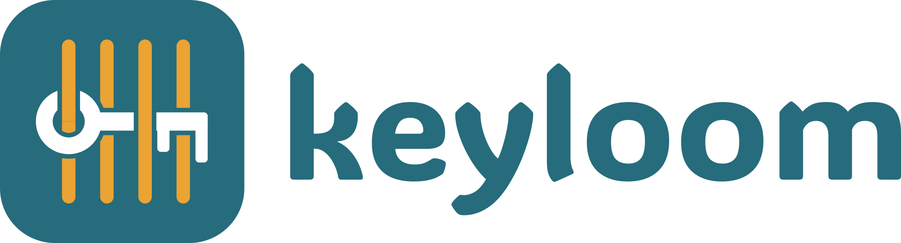

<!--
SPDX-FileCopyrightText: 2026 SEANERGYS Partners <https://seanergys.eu>
SPDX-License-Identifier: Apache-2.0
-->

  

Field-level encryption for configuration files: encrypt the secrets, keep the
rest readable.

- Documentation: https://seanergys.github.io/keyloom
- Issues: https://github.com/seanergys/keyloom/issues

keyloom is licensed under Apache-2.0.
